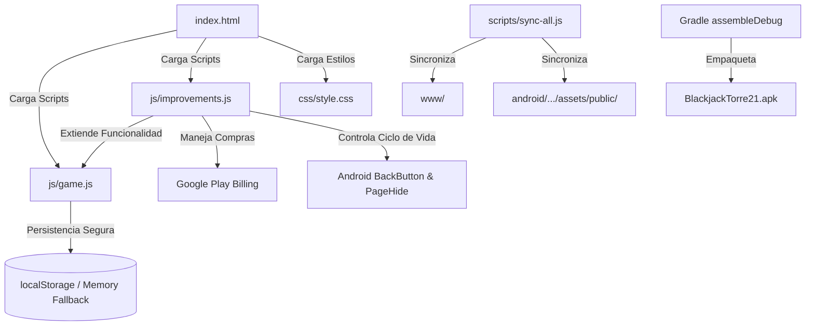

# 02 — INVENTARIO TÉCNICO Y ARQUITECTURA DEL PROYECTO

## 1. Tecnología Identificada

- **Plataforma:** Android Híbrido (Mobile WebView nativo).
- **Contenedor / Bridge:** **Capacitor 8.5.2** (`com.blacktower.roguelike`).
- **Núcleo de Ejecución:** HTML5 Semántico, CSS3 Vanilla estructurado y JavaScript Moderno (ES6+ sin transpiladores pesados).
- **Entorno de Construcción Android:**
  - Android Gradle Plugin: Compatible con Gradle 8.14.3.
  - SDK de Compilación: `compileSdkVersion = 36`, `targetSdkVersion = 36`, `minSdkVersion = 24` (Android 7.0 Nougat hasta Android 15/16).
  - Java Runtime: Java 21 LTS (`jdk-21.0.12.101-hotspot` de Eclipse Adoptium).
  - Configuración Capacitor: `capacitor.config.json` con `androidScheme: "https"`, splashscreen nativo y soporte de barra de estado oscura.

---

## 2. Mapa y Organización de Carpetas

```
C:\Proyectos\Juego de prueba\
├── index.html                       # Entrada principal (UI, pantallas DOM y modales)
├── js/
│   ├── game.js                      # Motor central de combate, estados, progresión y persistencia (~14.500 líneas)
│   └── improvements.js              # IIFE de mejoras, Google Play Billing, pactos y eventos móviles (~1.580 líneas)
├── css/
│   └── style.css                    # Sistema de diseño, layout responsivo y animaciones de marioneta (~9.950 líneas)
├── assets/
│   ├── fonts/                       # Fuentes locales offline WOFF2 (Fredoka y Nunito)
│   └── svg/                         # 57 archivos SVG vectoriales (héroes, enemigos, naipes, fondos, HUD)
├── www/                             # Espejo de distribución web para Capacitor
├── android/                         # Proyecto nativo Android Studio / Gradle
│   ├── app/src/main/assets/public/  # Espejo idéntico de la web embebida en la app Android
│   ├── app/src/main/AndroidManifest.xml
│   └── build.gradle
├── scripts/                         # Herramientas vivas (sync, integrity, build-apk y 32 test suites)
├── docs/
│   └── auditoria/                   # Documentación técnica formal de auditoría
├── BlackjackTorre21.apk             # Binario ejecutable compilado (Debug)
├── package.json                     # Definición de dependencias, plugins de Capacitor y suites de test
└── AGENTS.md                        # Reglas operativas y directrices de ingeniería
```

---

## 3. Componentes Principales y Responsabilidades

### A. Capa de Presentación e Interfaz (`index.html` & `css/style.css`)
- **Gestión por Overlays:** Utiliza un contenedor principal (`#stage`) para combate y un conjunto de paneles `div.overlay.hidden` para transiciones modales (menú de título, tienda, hoguera, ruleta, códice, ficha de héroe).
- **Diseño Vectorial Escalonado:** Los naipes y personajes se renderizan con SVG ligeros utilizando filtros CSS de iluminación, sombras de gota y animaciones de keyframes para simular marionetas de papel recortado.
- **Tipografías Embebidas:** Fuentes WOFF2 locales cargadas mediante `@font-face` relativo, garantizando funcionamiento 100% desconectado de internet.

### B. Motor del Juego (`js/game.js`)
- **Máquina de Estados de Partida (`gameState`):**
  - Control de pisos (`gameState.floor`), dificultad (`gameState.diff`), oro, racha de victorias y estado de combate.
  - Registro de estadísticas de partida para la pantalla de post-mortem (`runStats`).
- **Mecánicas de Naipes y Blackjack:**
  - Baraja estándar de 52 cartas + cartas de botín extra desbloqueables.
  - Cálculo de puntaje (`calculateHandScore`) con gestión adaptativa de Ases (1 u 11) y cartas dinámicas de la torre.
  - Resolución de turnos: Reparto inicial -> Acciones del jugador (Hit, Stand, Potion, Reroll, Bet) -> Turno del Crupier -> Comparación de puntuaciones y aplicación de daño físico / mitigación de escudo.
- **Progresión y Persistencia Anti-Trampas (`_saveSecure` / `_loadSecure`):**
  - Checksum FNV-1a con sal criptográfica para detectar manipulaciones externas en `localStorage`.
  - Fallback en memoria viva ante fallos o bloqueos temporales de almacenamiento.

### C. Módulo de Extensiones y Servicios (`js/improvements.js`)
- **Encapsulación IIFE:** Se ejecuta después de `game.js`, extendiendo y asegurando la estabilidad global mediante sobreescritura controlada de métodos expuestos en `window`.
- **Google Play Billing:** Integración con `@capacitor-community/billing` para compras legítimas de perks (Pack del Heredero, Tomo del Maestro, Bundle de Héroes).
- **Pactos del Abismo:** 20 condiciones y penalizaciones de riesgo/recompensa integradas en los eventos de inicio de piso y resolución de manos.
- **Gestión de Hardware Android:** Interceptación del botón físico Atrás y tecla Escape para cierre ordenado de modales y pausa.

---

## 4. Dependencias y Comunicación entre Módulos


