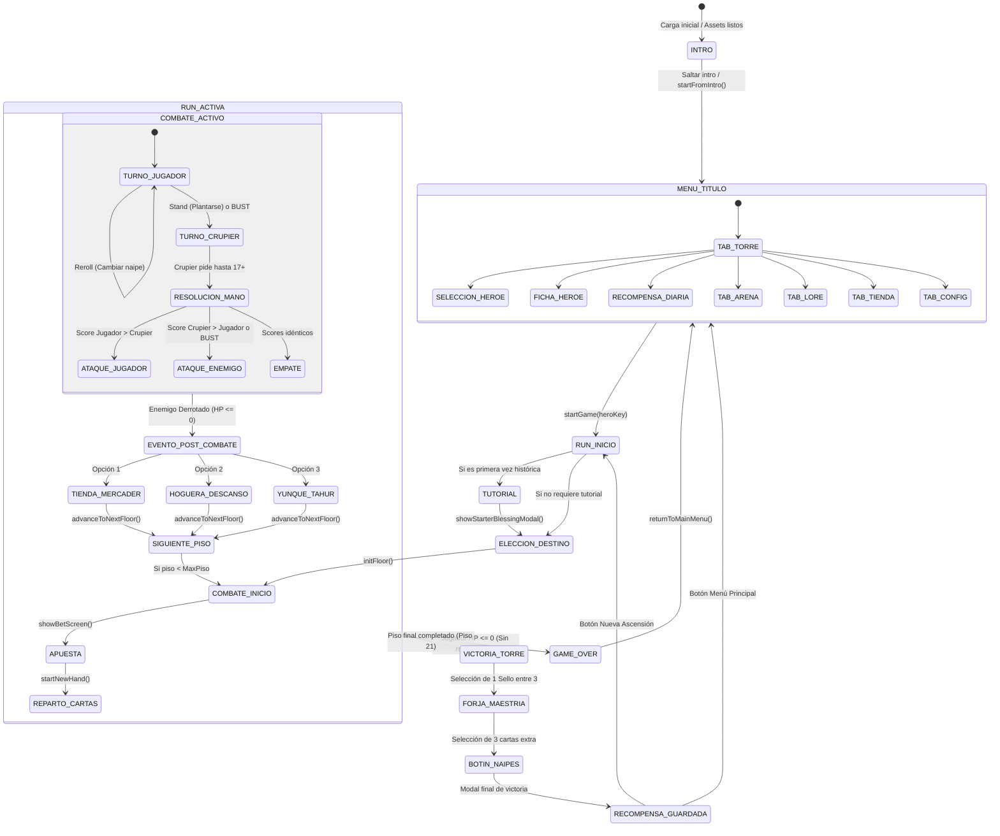

# 04 — LÓGICA DE JUEGO, MÁQUINA DE ESTADOS Y CASOS DE PRUEBA

## 1. Diagrama de la Máquina de Estados del Juego

---

## 2. Reglas Verificadas Exhaustivamente

1. **Valores de Blackjack:**
   - Naipes numéricos 2 al 10: valor nominal.
   - Figuras (J, Q, K): valor 10.
   - As: valor adaptativo 11 o 1 según evite pasarse de 21.
   - Blackjack natural: As + Figura en mano inicial de 2 cartas (multiplicador x3 o x3.5 con Tahúr).
2. **Límite de la Casa / Crupier:**
   - La IA del croupier siempre pide carta con puntaje menor a 17 y se planta estrictamente en 17 o superior.
3. **Escala de Pisos y Dificultad:**
   - Normal: 7 pisos.
   - Heroico: 9 pisos.
   - Mítico: 11 pisos.
   - Pesadilla: 13 pisos (con escalado de salud e inmunidad al rubber-banding).
4. **Monetización Ética:**
   - La moneda de juego (Oro, EXP, Monedas de Cripta) se obtiene mediante jugabilidad limpia.
   - Ningún perk premium (Pack del Heredero, Tomo del Maestro, Bundle de Héroes) se entrega sin validación real por Google Play Billing.

---

## 3. Matriz de Cobertura de las 32 Test Suites

| # | Archivo de Prueba | Componente Auditado | Resultado |
|---|---|---|---|
| 1 | `test-catalogs.js` | Catálogos de héroes, artefactos y reliquias | **PASS** (100%) |
| 2 | `test-lore-grimoire.js` | Grimorio de historias, capítulos y pergaminos | **PASS** (100%) |
| 3 | `test-sprint1-progression.js` | Niveles permanentes, stats base y curvas de EXP | **PASS** (100%) |
| 4 | `test-sprint3-archetype-forge.js` | Arquetipos de clase y forja de runas | **PASS** (100%) |
| 5 | `test-sprint4-tactical-perks.js` | 15 Perks tácticos condicionales en combate | **PASS** (100%) |
| 6 | `test-sprint5-hero-sheet.js` | Ficha del Héroe, atributos y cálculo de poder | **PASS** (100%) |
| 7 | `test-sprint6-audio-run-summary.js` | Audio, efectos de sonido y widget de post-mortem | **PASS** (100%) |
| 8 | `test-sprint-gamble-and-filters.js` | Filtros por palo y Yunque del Tahúr | **PASS** (100%) |
| 9 | `test-sprint-difficulty-and-perks.js` | Escalado de dificultades y balance de pisos | **PASS** (100%) |
| 10 | `test-retention-and-improvements.js` | Eventos semanales y retención diaria | **PASS** (100%) |
| 11 | `test-reward-modal-flow.js` | Flujo de recompensas tras despejar piso | **PASS** (100%) |
| 12 | `test-abyss-pacts.js` | 20 Pactos del Abismo y cableado de penalizaciones | **PASS** (100%) |
| 13 | `test-royal-billing.js` | Google Play Billing y migración de claves legadas | **PASS** (100%) |
| 14 | `test-catalog-integrity.js` | Coherencia de IDs y ausencia de referencias rotas | **PASS** (100%) |
| 15 | `test-daily-login.js` | Ciclo de 7 días de recompensas de conexión | **PASS** (100%) |
| 16 | `test-sprites.js` | 57 Sprites SVG y consistencia de nombres | **PASS** (100%) |
| 17 | `test-victory-rewards.js` | Entrega de 100 criptas y flujo de victoria | **PASS** (100%) |
| 18 | `test-phase4-ui-daily-hero.js` | Botones de acceso rápido y UI de héroes | **PASS** (100%) |
| 19 | `test-phase3-skin-synergies.js` | Skins cosméticas y bonificaciones arcanas | **PASS** (100%) |
| 20 | `test-phase5-menu-unification.js` | Navegación entre las 5 pestañas de menú | **PASS** (100%) |
| 21 | `test-buff-audit.js` | Modificadores de daño, defensa y efectos de estado | **PASS** (100%) |
| 22 | `test-effects-wiring.js` | Cableado de reliquias y accesorios | **PASS** (100%) |
| 23 | `test-phase1-mobile-blockers.js` | Safe areas, notch y prevención de bloqueos móviles | **PASS** (100%) |
| 24 | `test-phase2-combat-touch-explains.js` | Inspección táctil de naipes y estados en combate | **PASS** (100%) |
| 25 | `test-phase3-dossier-artifacts.js` | Dossier del héroe y visualización de equipamiento | **PASS** (100%) |
| 26 | `test-phase4-idle-animations.js` | Animaciones de reposo marioneta de papel | **PASS** (100%) |
| 27 | `test-phase5-clutch-draw-bias.js` | Mecánica de robo clutch en situaciones críticas | **PASS** (100%) |
| 28 | `test-phase6-victory-cards.js` | Persistencia y guardado de cartas de victoria | **PASS** (100%) |
| 29 | `test-phase7-wheel-visuals.js` | Visuales y animaciones de la Ruleta del Destino | **PASS** (100%) |
| 30 | `test-gambler-pact.js` | Apuesta mínima 10 HP y Blackjack x3.5 del Tahúr | **PASS** (100%) |
| 31 | `test-phase-c-victory-loot.js` | Deduplicación de botín (máx 12) y pestaña "Mi Mazo" | **PASS** (100%) |
| 32 | `test-phase-e-dynamic-cards.js` | Cartas dinámicas y catálogo de combate de la Arena | **PASS** (100%) |
